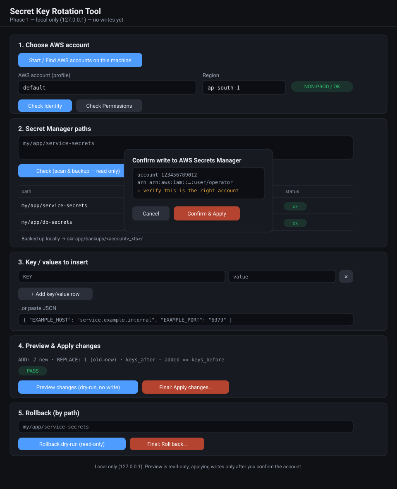

# Secret Key Rotation Tool (portable)



> The image above is a representative mockup of the single-page UI (not a live screenshot). The real page is served from `skr-app/index.html` when you run the script.

A **local-only** web tool to safely add / update keys in many AWS Secrets Manager
secrets at once, with per-path key-count verification, local backups, and a
rollback path. Nothing is exposed to the internet — the backend binds to
`127.0.0.1` only and uses the AWS credentials/profiles already on the machine.

This repo ships a **single self-contained script** (`secret-key-rotation.sh`)
that writes its own files, installs dependencies, and launches the tool. It
exists because older ad-hoc scripts corrupted secret values that contain line
breaks / escapes (e.g. a PEM private key: `"-----BEGIN...\n...\n-----END...\n"`).
This tool does all parsing, counting, merging and verification **locally** with
proper JSON engines, and only touches AWS to **read** the current value and —
after you confirm — to **write** the final merged value.

---

## Quick start

```bash
chmod +x secret-key-rotation.sh
./secret-key-rotation.sh
```

On run it:
1. verifies Python 3 (and checks for jq — optional),
2. writes `server.py` + `index.html` into a local `skr-app/` folder,
3. creates a local `.venv` and installs `boto3` (only if missing),
4. starts the backend and **prints the URL**.

The port is derived from the launch time: 24-hour `HHMM` with a `7` appended
(e.g. 17:13 → `17137`). Override with `PORT=8888 ./secret-key-rotation.sh`.

---

## Prerequisites
- **Python 3** (the script sets up its own virtualenv and installs `boto3`).
- **AWS credentials/profiles** already configured on the machine
  (`~/.aws/config` / `~/.aws/credentials`, or `AWS_PROFILE`).
- **jq** (optional) — enables the independent cross-check column. `brew install jq`.

---

## How it works (the safe mechanism)

Secrets Manager has **no "add one key" API**. `put-secret-value` replaces the
whole `SecretString`. So per secret the tool does:

```
GetSecretValue (raw)  ->  parse JSON locally  ->  merge keys in memory  ->  PutSecretValue (whole merged JSON)
```

- Parsing/serialization use Python's `json` module (and `jq` only as an
  independent verifier) — **never** shell string-building, `sed`, or inline
  `jq` construction. This preserves `\n`, `\"`, `\\`, tabs, unicode.
- The write sends the value via a **temp file**, never an inline CLI arg.

---

## The workflow (on the page)

### 1. Choose AWS account
- **Start / Find AWS accounts** — backend scans the machine for all profiles,
  resolves each account id + ARN (read-only `sts get-caller-identity`), and
  **saves the list to a per-machine cache** (`skr-app/accounts.cache.json`).
  Later sessions load it instantly; re-press after adding a new account.
- **Check Identity** — shows the real account number + ARN; flags prod.
- **Check Permissions** — non-mutating IAM simulation of
  `GetSecretValue`/`DescribeSecret`/`PutSecretValue`.

### 2. Secret paths — Check (scan & backup, read only)
- Per path: current key count (counted two ways — Python and jq) + a match flag,
  and a local backup of the full current value into
  `skr-app/backups/<account>_<timestamp>/`.
- **jq Verify** — re-counts from local backups with jq to confirm nothing lost.

### 3. Key / values to insert
- Add rows, or paste JSON and load it.

### 4. Preview & Apply
- **Preview (dry-run)** — per path shows ADD (new) vs REPLACE (old→new) and the
  safety math `keys_after − added == keys_before` (PASS = no existing key lost).
- **Final: Apply…** — confirm modal shows the **account number + ARN** (+ prod
  warning). On Confirm: fresh backup → merge → re-verify → scan→apply **drift
  check** → `put-secret-value`.

### 5. Rollback (by path)
- **Dry-run** shows current vs backup counts and which keys get removed/restored.
- **Final: Roll back…** — same confirm modal; restores the full backup snapshot.

---

## Issues handled
- PEM / escaped values (`\n`, `\"`, `\\`, tabs) — JSON engine only, no shell/jq
  string construction (no `\n` doubling or collapsing).
- Whole-blob merge preserves existing keys; replaced keys shown old→new.
- Dual key count (Python + jq) and the `after − added == before` equation.
- Scan→apply drift check aborts a path if the secret changed in between.
- Values written via temp file; never printed back; never inline args.
- Account + ARN always shown; prod flagged; explicit confirm before any write.
- Non-JSON / plaintext / binary secrets are blocked, never overwritten.
- Localhost only; refuses to bind to anything but `127.0.0.1`.
- No hardcoded accounts/org names — accounts are discovered at runtime.

---

## Files
| Path | Purpose |
|---|---|
| `secret-key-rotation.sh` | The one file to copy & run. Sets up and launches. |
| `skr-app/` | Created on first run: `server.py`, `index.html`, `.venv`, `backups/`, cache. Git-ignored. |
| `README.md` / `CLAUDE.md` / `AGENTS.md` | Docs + agent context. |
| `.kiro/steering/` | Kiro steering (product / tech / structure). |

Only reads/previews/discovery are read-only. Only **Apply** and
**Rollback → Confirm** write to AWS. Default region `ap-south-1`
(override with env `SKR_DEFAULT_REGION`).
